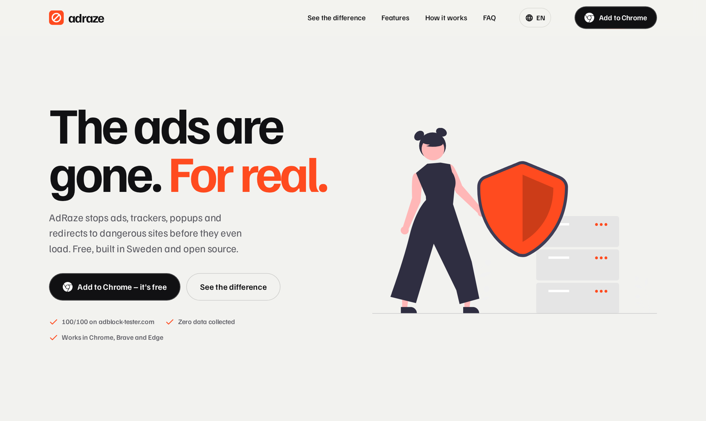
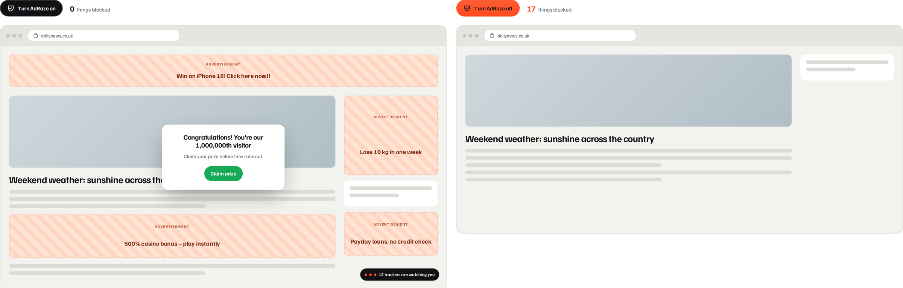
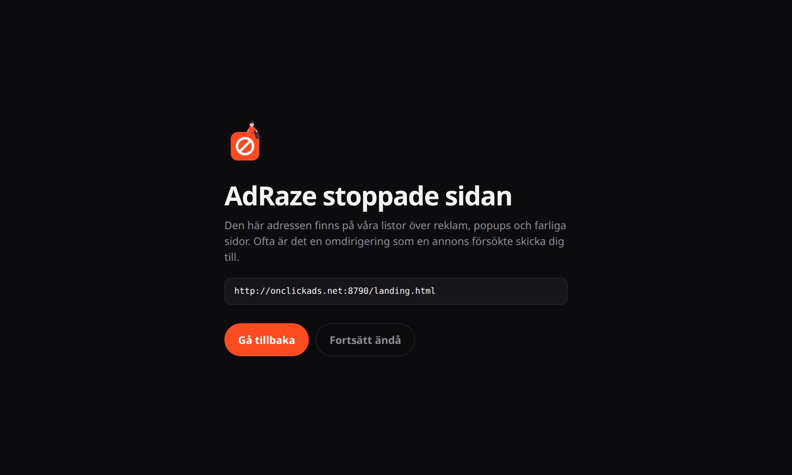

<div align="center">


# AdRaze

**The ad blocker from Sweden.** Blocks ads, trackers, popups and malicious redirects before they load.

[](LICENSE)
[](https://developer.chrome.com/docs/extensions/develop/migrate/what-is-mv3)
[](https://github.com/northcrafto/adraze/releases)
[](https://github.com/northcrafto/adraze/actions/workflows/build.yml)
[](https://adraze.app)

[Website](https://adraze.app) · [Download](https://github.com/northcrafto/adraze/releases/latest) · [Report a broken site](https://github.com/northcrafto/adraze/issues/new?template=broken-site.yml) · [Privacy](https://adraze.app/en/integritet)



</div>

## Why AdRaze

Most ad blockers hide banners. AdRaze also goes after the things that make the web feel hostile: popunders that open when you click anywhere, invisible overlays that send you to a casino, and ad scripts that hijack the whole tab and redirect you to a scam page.

It is built on Chrome's native `declarativeNetRequest` engine, so blocking happens inside the browser before a request is even sent. No remote servers, no accounts, no telemetry.

<div align="center">

</div>

## Features

| | |
|---|---|
| **Ads** | Banners, video ads and sponsored boxes never load. Empty ad slots are collapsed so pages look normal. |
| **Trackers** | Analytics scripts and ad networks that follow you across sites are blocked with EasyPrivacy. |
| **Popups and popunders** | Windows opened by clicks on non-interactive parts of the page are stopped, and invisible full-page click traps are removed. Sign-in and payment popups (Google, Apple, Microsoft, PayPal, Klarna, BankID and more) always work. |
| **Malicious redirects** | Known scam, malware and popup-network domains, and tab redirects started by an ad domain, land on AdRaze's stop page instead. You decide whether to continue. |
| **Swedish sites** | Ships with Frellwit's Swedish Filter on top of the international lists. |
| **Pause per site** | One click in the toolbar menu pauses AdRaze on a site you want to support. |

<div align="center">

</div>

## Results

Measured on 19 October 2026 in Chromium 1248, with and without the extension:

| Test | Without AdRaze | With AdRaze |
|---|---|---|
| [adblock-tester.com](https://adblock-tester.com) | 41 / 100 | **100 / 100** |
| Ad domains loaded on blocket.se | 35 | **0** |
| Ad domains loaded on aftonbladet.se | 5 | **0** |
| Ad domains loaded on expressen.se | 3 | **0** |

## Install

AdRaze is on its way to the Chrome Web Store. Until then:

1. Download `adraze-x.y.z.zip` from the [latest release](https://github.com/northcrafto/adraze/releases/latest) and unzip it.
2. Open `chrome://extensions` and turn on **Developer mode**.
3. Click **Load unpacked** and select the unzipped folder.

Works in Chrome, Brave, Edge, Opera and other Chromium browsers (version 121 or later). In Brave you can turn off Shields if you want AdRaze to do all the blocking.

## Build from source

Requires Node.js 18+.

```sh
git clone https://github.com/northcrafto/adraze.git
cd adraze/tools
npm install
npx playwright-core install chromium   # optional, validates cosmetic selectors
node build.js --fetch                  # downloads the filter lists and writes extension/rules + extension/data
```

Then load the `extension/` folder as an unpacked extension.

## How it works

```
filter lists ──► tools/build.js ──► extension/rules/*.json      network rules (declarativeNetRequest)
                                └─► extension/data/cosmetic.json  element-hiding CSS
                                └─► extension/data/popup-hosts.json
```

- **Network blocking:** `tools/build.js` converts Adblock Plus syntax to DNR rules with [`@eyeo/abp2dnr`](https://www.npmjs.com/package/@eyeo/abp2dnr), normalizes uBlock Origin option aliases, and merges plain `||host^` rules into `requestDomains` lists. About 120,000 filters fit in roughly 17,000 rules, well under Chrome's static rule limit.
- **Cosmetic filtering:** the background worker injects generic and site-specific element-hiding CSS per frame with `chrome.scripting.insertCSS`. Selectors are validated in Chromium at build time, so one bad selector can't break a whole stylesheet.
- **Popup guard:** `content/guard.js` runs in the page's main world at `document_start`. It wraps `window.open`, blocks cross-site popups that don't come from a real link or button, returns a harmless fake window so popunder scripts don't fall back to redirecting the tab, and removes invisible full-page anchors.
- **Stop page:** main-frame requests to known malicious or popup-network hosts, and main-frame navigations initiated by ad domains, are redirected to `blocked/blocked.html`. If that happens in a freshly opened popup tab, the tab is closed instead.

### Project structure

```
extension/        the Chrome extension (Manifest V3)
  background.js   cosmetic CSS, popup tab handling, stop page, pause per site
  content/        cosmetic.js (isolated world) and guard.js (main world)
  popup/          toolbar menu
  blocked/        stop page
  rules/ data/    generated by tools/build.js
tools/            filter list compiler
site/             adraze.app (static, 26 languages)
logo/             logo source (rita.py) and exports
tests/            Playwright harness for testing against real sites
```

## Contributing

Found a site where an ad slips through, a page breaks, or a popup gets past the guard? [Open an issue](https://github.com/northcrafto/adraze/issues/new/choose). See [CONTRIBUTING.md](CONTRIBUTING.md) for how to test changes.

## Privacy

AdRaze collects nothing. The list of paused sites and the popup counter are stored with `chrome.storage` on your own device. Full policy: [adraze.app/en/integritet](https://adraze.app/en/integritet).

## Credits

AdRaze would not exist without the people who maintain the filter lists:

- [EasyList and EasyPrivacy](https://easylist.to) (GPL-3.0 / CC BY-SA 3.0)
- [Frellwit's Swedish Filter](https://github.com/lassekongo83/Frellwits-filter-lists) (GPL-3.0)
- [uBlock Origin filters](https://github.com/uBlockOrigin/uAssets) (GPL-3.0)
- [AdGuard Popups filter](https://github.com/AdguardTeam/AdguardFilters) (GPL-3.0)
- [Peter Lowe's ad server list](https://pgl.yoyo.org/adservers/)

Website illustrations from [unDraw](https://undraw.co), photos from [Pexels](https://www.pexels.com), globe by [cobe](https://github.com/shuding/cobe). Built with help from [Claude](https://claude.ai).

## License

[GPL-3.0](LICENSE) © 2026 northcrafto
