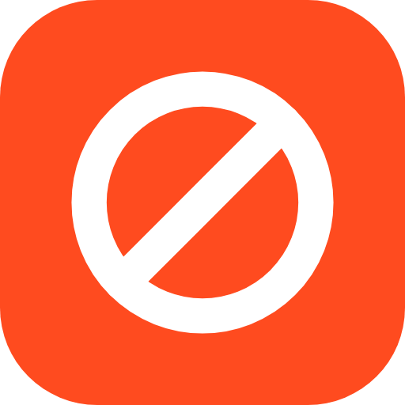

<p align="center">
  
</p>

<h1 align="center">AdRaze Browser</h1>

<p align="center">
  A desktop browser with the AdRaze ad blocker built in. Ads, trackers, popups and dangerous pages are stopped before they load.
</p>

<p align="center">
  <a href="https://github.com/northcrafto/adraze-dl/releases/latest"></a>
  <a href="LICENSE"></a>
</p>

<p align="center">
  <a href="https://github.com/northcrafto/adraze-dl/releases/latest/download/AdRaze.AppImage"><b>Download for Linux</b></a> ·
  <a href="https://adraze.app">adraze.app</a>
</p>

## What it does

- **AdRaze blocking built in.** The same rules as the AdRaze extension (`../extension`), matched inside the browser itself, so it is not limited by Chrome's extension policies. Cookie banners are rejected automatically.
- **Dangerous pages are stopped.** Scam, malware and popup-network pages land on a full-screen warning instead of loading. You decide whether to continue.
- **Logins keep working.** Sign-in, 2FA, captcha and payment providers (Google, GitHub, Microsoft, Apple, BankID, Stripe, PayPal, Klarna and more) are never blocked.
- **Password manager.** Pick a saved login from a list under the field, get a strong password suggestion on sign-up forms, and choose whether to save. Nothing is filled in silently.
- **54 languages**, Swedish first.
- **Updates itself** in the background on Linux.

## Run from source

```bash
git clone https://github.com/northcrafto/adraze.git
cd adraze/browser
npm install          # downloads the castLabs Electron build (Widevine-enabled)
npm start            # copies the rules from ../extension and starts the browser
```

Requirements: Node.js 22 or newer.

## Packaging

| Target | Command |
| --- | --- |
| Linux AppImage + release | `tools/release.sh "what changed"` |
| Microsoft Store (MSIX) | `tools/msix.sh` (needs `makemsix` from microsoft/msix-packaging) |

## How the code is organised

```
main.js              Electron main process: windows, tabs, downloads, updates, IPC
adblock-adraze.js    The AdRaze engine: network rules, cosmetic CSS, cookie banners, danger checks
adraze-preload.js    Runs the extension's page scripts (cosmetics, cookie banners, YouTube) inside tabs
content-preload.js   Runs inside pages: password detection, the login picker, autofill on request
preload.js           Bridge between the shell UI and the main process
scanner.js           Dangerous-site checks
ui/                  The shell (shell.html/js, input.css → tailwind.css), settings, popups
tools/               Rule sync, translations, release and MSIX scripts
build/               Icons and packaging hooks
```

## License

The browser is released under the [Mozilla Public License 2.0](LICENSE). Filter lists keep their own licenses (EasyList and EasyPrivacy: GPLv3 / CC BY-SA 3.0; Frellwit's Swedish Filter: see its repository). Electron and Chromium are covered by their respective licenses.

<p align="center">Made in Sweden.</p>
